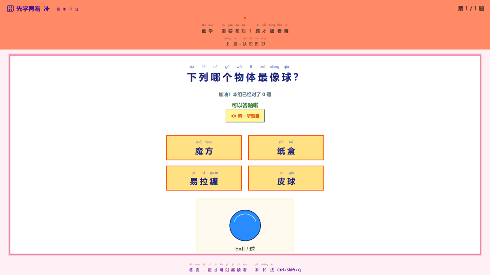
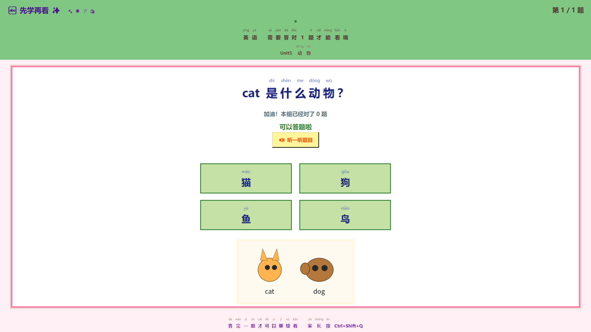
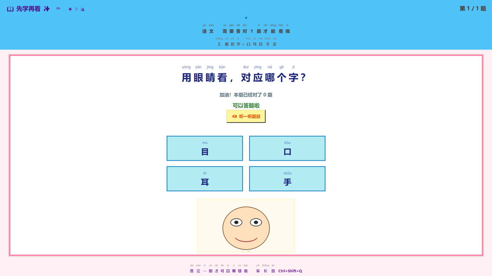
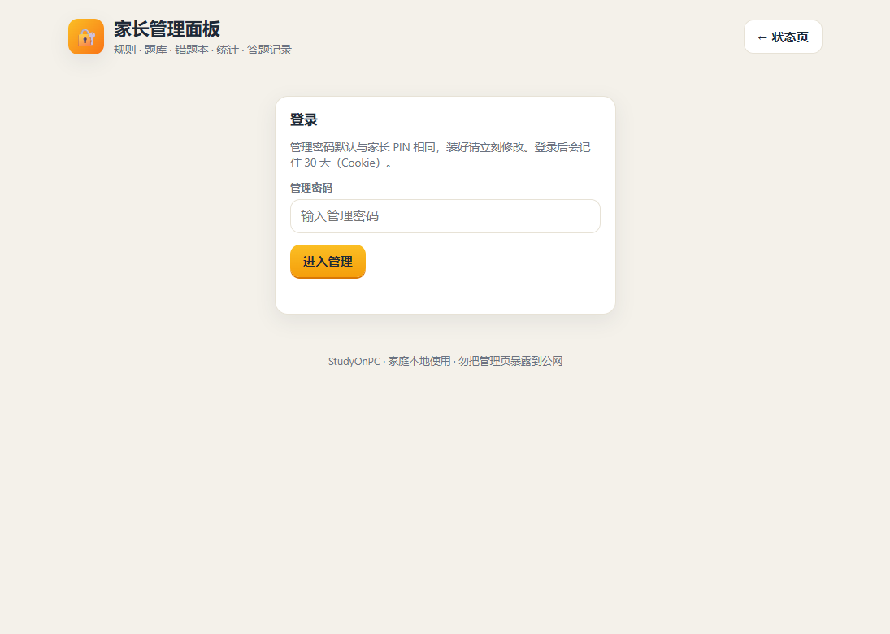
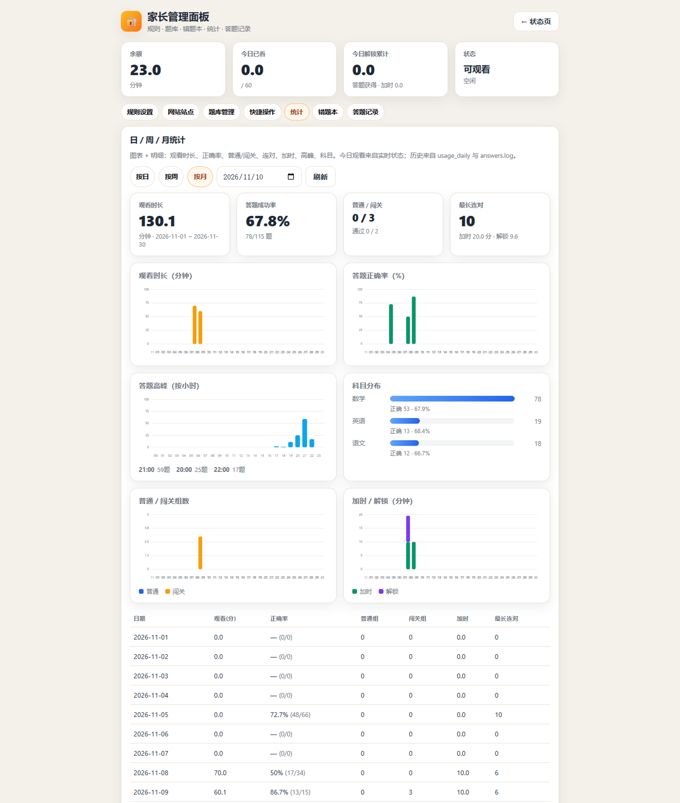
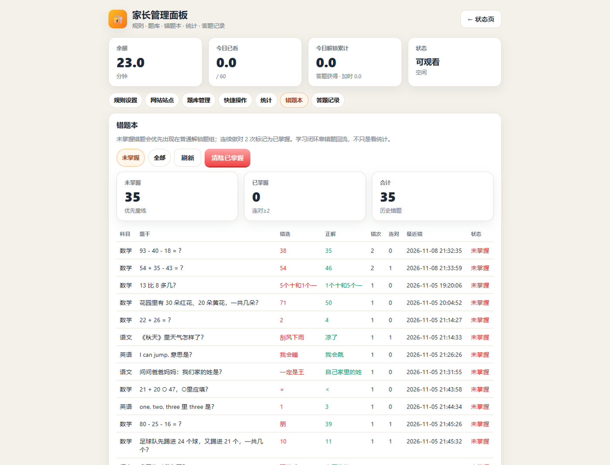

# StudyOnPC（Windows · 先学再看）

孩子在 Windows 上用 Chrome 看 YouTube 时，会消耗「解锁观看时长」。**余额为 0** 或 **今日已达上限** 时，全屏弹出题组；答对够题数才解锁更多分钟。家长 PIN 才能退出；主程序与看门狗互相拉起。

> **声明**：本仓库为**原创代码**。产品玩法（答题解锁时长、每日上限、局域网管理、多题型等）**思路借鉴**开源项目 [StudyOnTV](https://github.com/chadyi/StudyOnTV)（Personal Use Only，仅限个人家庭使用）。**不是 StudyOnTV 的 fork，未使用其源码。** 家庭自用请遵守对方许可证精神；请勿整包再分发对方代码。

前台检测 / 静音 / PIN / 看门狗升级自本机既有「YouTube 一年级助手」。

## 界面预览

全屏答题界面（童趣配色 + 拼音标注 + 插图 +「听一听」），答对够题数才解锁观看时长：



*数学 · 认识图形（插图题）*



*英语 · Unit5 动物（插图题）*



*语文 · 口耳目手足（插图题）*

家长管理页（同一 WiFi 打开 `http://电脑IP:8099/admin`）：登录后可查看用量统计图表，以及并排显示「错选 / 正解」的错题本。



*管理页登录*



*统计 · 观看时长、正确率、科目与加时（按月）*



*错题本 · 并排显示错选和正解*

## 多站点与语音（v1）

- **多站点 `sites[]`**：共享解锁余额；每个站点独立关键词、每组解锁分钟、每日上限、题数与及格线。旧配置的 `youtube_keywords` 会自动迁移成一个 YouTube 站点。
- **家长管理页** `/admin`：可编辑站点、规则、题库；「今日加时」增加共享余额并抬高今日有效上限；看满每日上限后可「大闯关」（固定 5 题，按 pass_ratio 约需对 4 题，过关加时 10 分钟）；日/周/月统计图表；错题本并排列出错选与正解，未掌握题会优先重练；可开关火山引擎 TTS。
- **答题页「听一听」**：调用火山 / 字节跳动 openspeech **TTS V3 SSE**（`api_key` 只写在本地 `config.json`，示例见 `config.example.json`）。与 [CaptainChen](https://github.com/yuefengkai/CaptainChen) 同源协议。
- 答题界面更童趣：更亮的配色、贴纸装饰、更大的选项按钮。

填写火山密钥（本地，**勿提交**）：

1. 复制 `config.example.json` → `config.json`（或在管理页 TTS 区填写）
2. 在 [火山引擎控制台](https://console.volcengine.com/) 开通「大模型语音合成」，拿到 **API Key**（对应请求头 `X-Api-Key`）
3. 设置 `tts.enabled=true`，填入 `tts.api_key`；`tts.speaker` 如 `zh_male_tiancaitongsheng_uranus_bigtts`；`tts.resource_id` 缺省 `seed-tts-1.0`
4. 若你有 CaptainChen 工程的本地 `Secrets.plist`：把 `VolcanoApiKey` → `tts.api_key`，`VolcanoSpeaker` → `tts.speaker`，`VolcanoResourceId` → `tts.resource_id`
5. 旧配置里的 `appid` / `token` / `cluster` / `voice_type`（V1）会被忽略，请改用上面的 V3 字段
6. 保存后重新打开答题页，点「听一听题目」；V3 失败且 `system_fallback=true` 时会尝试 Windows 系统朗读


## Windows 可执行文件（推荐）

在 Windows 上：

```powershell
cd C:\path\to\StudyOnPC
.\build_exe.ps1
```

产物默认复制到项目旁的 `StudyOnPC-dist\`（可用环境变量 `STUDYONPC_DIST` 覆盖）：

- **`StudyOnPC.exe`（onefile 单文件）** — CI Artifact 也只上传这一个 exe
- 首次运行会在 **exe 同目录** 自动写出可写数据：`config.json`、`data\`、`logs\`、`scripts\set_mute.ps1`（从包内 `_MEIPASS` 播种；不会改只读临时解压目录）
- 开机启动 / 卸载等辅助脚本仍在源码仓库（`install.ps1`、`uninstall.ps1`、`parent_quit.ps1`），需要时拷到 exe 旁边再跑
- CLI：`StudyOnPC.exe --once --force` / `--role=watchdog`

> onefile 启动时会解压到临时目录，冷启动比 onedir 稍慢；日常使用仍只需分发这一个 exe。

家长管理页（同一 WiFi）：`http://电脑IP:8099/` 与 `/admin`（卡片仪表盘、规则、题库、统计图表、错题本、强制出题、答题记录）。


## 家长必读

| 操作 | 做法 |
|------|------|
| **首次配置** | 复制 `config.example.json` → `config.json`，修改其中的 `parent_pin` / `admin_password` |
| **临时退出** | **Ctrl+Shift+Q**，或运行 `parent_quit.ps1`，输入你在 `config.json` 里设置的 PIN |
| **彻底卸载** | `uninstall.ps1` → 输入 PIN |
| **改 PIN / 规则** | 编辑 `config.json`，或打开管理页 `http://电脑IP:8099/admin` |
| **强制出一题组** | 管理页「立即出题」，或 `pythonw studyonpc.py --once --force`（要看控制台则加 `--console`） |

仓库只提交 **`config.example.json`**（示例口令仅为占位，见该文件）。本地真实口令写在 **`config.json`**（已 gitignore，请勿提交）。

## 安装（Windows）

需要 Python 3.10+（建议装过 tkinter），看图题需 Pillow：

```powershell
cd C:\path\to\StudyOnPC
copy config.example.json config.json
# 编辑 config.json，改掉 parent_pin / admin_password
pip install -r requirements.txt
powershell -ExecutionPolicy Bypass -File .\install.ps1
```

也可双击 **`start.vbs` / `start.bat`**（`pythonw` 隐藏启动，无黑窗口；关这个启动窗也停不掉进程）。调试看日志请用 **`start-console.bat`**（会显示控制台，带 `--console`）。

打包的 `StudyOnPC.exe`（`StudyOnPC.spec` 已 `console=False`）本身无控制台；看门狗互拉也走 `pythonw` / 无窗口子进程。

## 默认规则（见 `config.example.json`）

- 每组 **3** 题，正确率 ≥ **约 2/3**（`pass_ratio` 默认 0.6667，即至少 2 题）→ 解锁 **10** 分钟  
- 每日最多看 **60** 分钟  
- 连续错 **3** 题 → 下组加 **1** 道补题  
- 只统计前台标题含 `youtube` / `youtu.be` 的时间  
- 管理端口 **8099**
- 每题先看题 **`answer_delay_seconds`（默认 5 秒）** 后才能点选项；选项每次**随机打乱**

余额与今日已用存在 `data/state.json`（按系统本地日期日切；中国区电脑一般为东八区）。

## 拼音标注

答题界面的**题目与选项**会自动加 **拼音**（`pypinyin`），方便一年级小朋友认字：汉字上方显示声调拼音，英文/数字/算式保持原样。反馈语、科目名也会带拼音。

依赖：`pip install -r requirements.txt`（含 `pypinyin`、`Pillow`）。

## 题库

- 默认：`data/banks/grade1-shenzhen.json`（深圳一年级语数英 **156** 题，覆盖部编语文拼音识字课文技能、数学 20 以内与图形、沪教牛津英语启蒙主题；插图在 `assets/images/`）  
- 也支持开放字段：`type`=`single|multiple|boolean|text`，以及 `q` / `a` / `answers` / `correctIndices` / `k` / `difficulty`（见 `data/banks/sample-open-format.json`）  
- 无答案关键字的主观题 MVP 会跳过

## 行为摘要

1. 余额 > 0 且未达每日上限：前台看 YouTube 时扣余额。  
2. 否则（且前台是 YouTube，或家长强制）：静音 + 最小化 YouTube → 全屏题组。  
3. 达标：恢复播放、写入解锁分钟。未达标：再来一组。  
4. 主进程 ↔ 看门狗约 3 秒互查；`logs/stop.flag` 表示家长已要求停止。

## 自检（可在 Linux 开发机跑）

```bash
cd studyonpc
python -m unittest tests/test_rules.py tests/test_bank.py -v
```

## 目录

```
studyonpc.py            入口
config.example.json     示例配置（可提交）
config.json             本地真实配置（gitignore，自行复制生成）
studyonpc/              Python 包
data/banks/             题库
data/state.json         运行时状态（自动生成，gitignore）
assets/images/          插图
scripts/                set_mute.ps1 等
install.ps1 / start.bat / parent_quit.ps1 / uninstall.ps1
logs/                   日志与 PID（gitignore）
```

## 明确延后

间隔重复记忆、星星奖励、主观题 AI 批改、锁屏级多应用管控（当前只盯 YouTube）。
